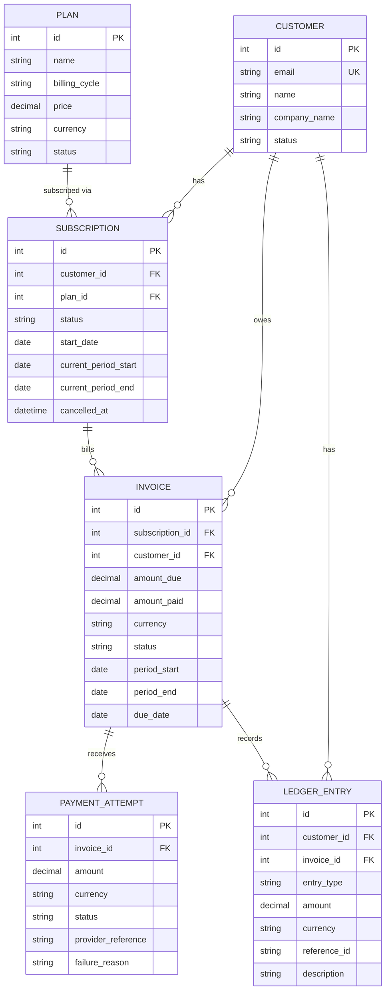

# SubLedger — Low-Level Design

## Layers

```
HTTP route (views/)  →  schema (schemas.py: validate in / serialize out)
        ↓
service (services/)  →  business rules, workflows, transactions
        ↓
repository (repositories/)  →  all ORM queries and writes
        ↓
model (models.py) + DB constraints
```
`config/` holds settings (env-driven) and root URLs. `dependencies.py` is the composition root: services receive their repositories (and other services) through the constructor, so nothing builds its own collaborators inline and services are testable with fakes.

## ERD


Fields added beyond the brief: none in the core tables. `LedgerEntry.reference_id` is a string (`invoice:<id>` / `payment_attempt:<id>`) because it points at different tables depending on `entry_type`.

## Service responsibilities

| Service | Owns | Must not |
| :-- | :-- | :-- |
| PlanService | price > 0, plan status changes | touch subscriptions |
| CustomerService | create, email uniqueness (case-insensitive), fetch | write ledger |
| SubscriptionService | customer/plan existence, inactive-plan check, duplicate-active check, period calc, cancel | create invoices |
| InvoiceService | generate invoice, snapshot `amount_due` from plan price, billing period, apply successful payment to `amount_paid`/status | record payments |
| PaymentService | validate payment, create attempt, trigger invoice update + ledger entry | compute invoice status itself |
| LedgerService | append entries, fetch customer ledger | update or delete entries |

## Repository responsibilities

| Repository | Reads/writes | Common methods |
| :-- | :-- | :-- |
| PlanRepository | Plan | create, get, list, save |
| CustomerRepository | Customer | create, get, list, email_exists |
| SubscriptionRepository | Subscription | create, get, get_active, list, save |
| InvoiceRepository | Invoice | create, get, get_for_update, exists_for_period, save |
| PaymentAttemptRepository | PaymentAttempt | create |
| LedgerRepository | LedgerEntry | append, list_for_customer (no update/delete) |

## Business-rule ownership

| Rule | Schema | Service | Repository | Model / DB |
| :-- | :-- | :-- | :-- | :-- |
| Plan price > 0 | `min_value` | PlanService | | CHECK `plan_price_gt_0` |
| Customer email unique | EmailField | CustomerService | catches IntegrityError → 409 | UNIQUE(email) |
| No subscription to inactive plan | | SubscriptionService | | |
| One active subscription per customer+plan | | SubscriptionService | maps IntegrityError → 409 | partial UNIQUE (status=active) |
| Invoice amount from plan price at generation | | InvoiceService | | |
| One invoice per subscription period | | InvoiceService | maps IntegrityError → 409 | partial UNIQUE (non-void) |
| Payment ≤ remaining unpaid | amount > 0 | PaymentService | row lock (`get_for_update`) | CHECK `amount_paid <= amount_due` |
| Paid / partially_paid status | | InvoiceService | | |
| Failed payment doesn't raise amount_paid | | PaymentService | | |
| Ledger append-only | | LedgerService | no update/delete methods | model `save`/`delete` and queryset `update`/`delete` raise |

## Design pattern: Repository + Service Layer

Services hold workflow and rules; repositories hold every query. Reason: rules like "payment cannot exceed unpaid amount" are testable and readable without HTTP or ORM details, route handlers stay thin, and swapping persistence (or faking it in tests) touches one layer. Database constraints back the important rules so races (two concurrent payments, double-submit) cannot corrupt data even if a service check is bypassed. Services use `transaction.atomic` so invoice + attempt + ledger writes commit together.

## Invoice generation flow
1. Route validates `subscription_id` and optional `period_start`/`period_end` (both or neither).
2. InvoiceService loads the subscription via SubscriptionRepository (404 if missing); must be active.
3. Period = given, else the subscription's current period; reject if end ≤ start or an invoice exists for it.
4. `amount_due` = plan price now; currency from plan; status `issued`; `due_date` = today + `INVOICE_DUE_DAYS`.
5. InvoiceRepository creates the invoice.
6. LedgerService appends `invoice_created` (`reference_id=invoice:<id>`).
7. If the default period was billed, the subscription's period advances one cycle.
8. Steps 2–7 are one transaction; route returns 201 with the invoice.

## Payment recording flow
1. Route validates `invoice_id`, `amount > 0`, `currency`, `status` (success|failed), `provider_reference`, optional `failure_reason`.
2. PaymentService fetches the invoice with a row lock (404 if missing).
3. Reject if invoice is not issued/partially_paid/overdue, or currency differs.
4. If `success` and amount > remaining (`amount_due − amount_paid`) → 422.
5. PaymentAttemptRepository creates the attempt (failure reason stored for failed).
6. Success → InvoiceService adds to `amount_paid`; status becomes `paid` if fully covered else `partially_paid`. Failed → invoice untouched.
7. LedgerService appends `payment_success` / `payment_failure` (`reference_id=payment_attempt:<id>`).
8. One transaction; route returns the attempt and current invoice.
